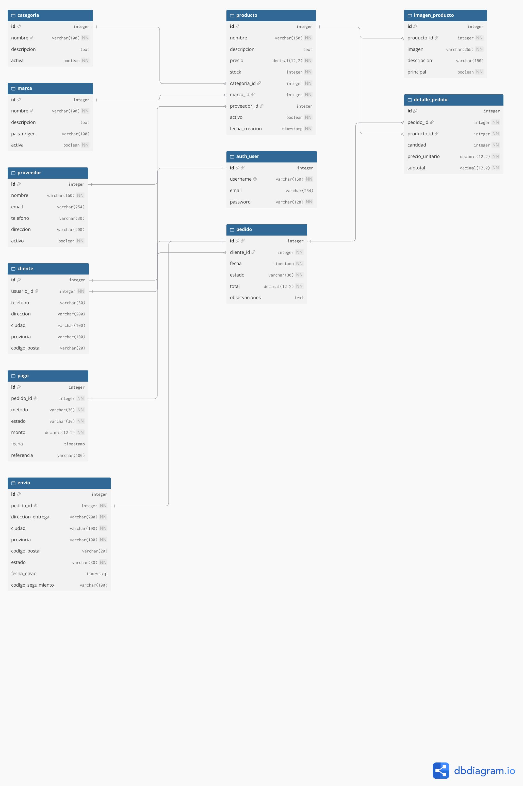

# stars-backend
API REST de STARS, tienda de instrumentos musicales. EFI 2026 - Ingeniería de Software con Django y Django REST Framework.

## Diseño de la base de datos

La base de datos de STARS fue planificada mediante
un diagrama entidad-relación realizado en dbdiagram.io.

El sistema cuenta con 10 modelos propios relacionados
entre sí: Categoria, Marca, Proveedor, Producto,
ImagenProducto, Cliente, Pedido, DetallePedido,
Pago y Envio.

También utiliza el modelo de usuario proporcionado
por Django para la autenticación.

### Diagrama entidad-relación

[Ver diagrama en PDF](docs/STARS_Diagrama_BD.pdf)
