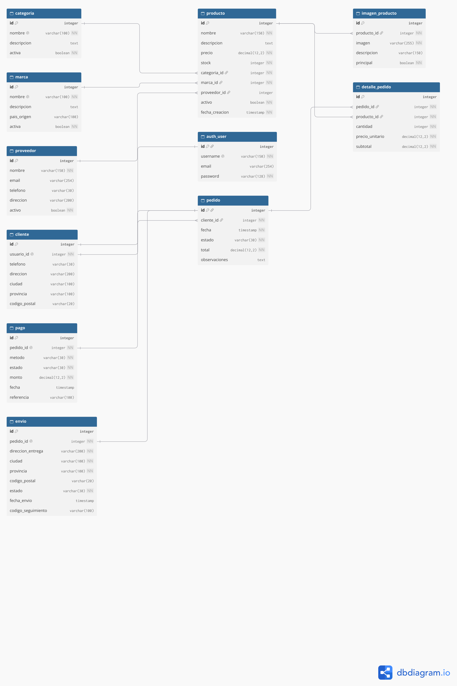
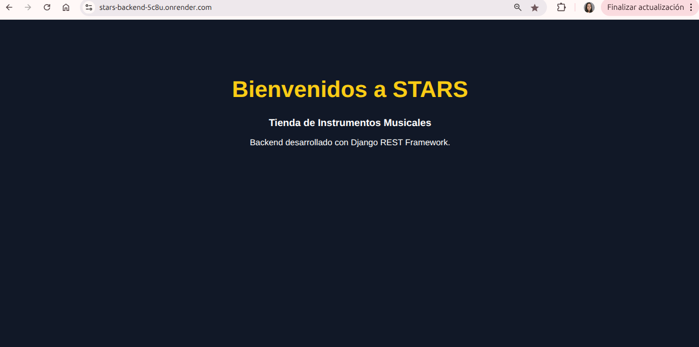
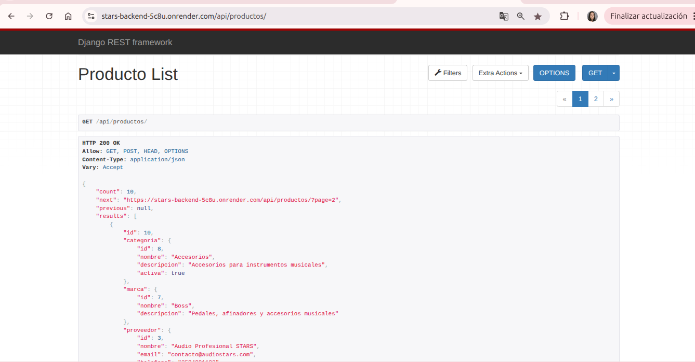
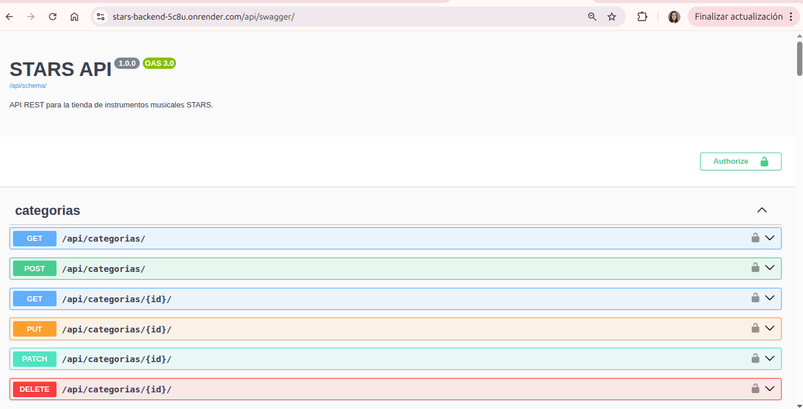
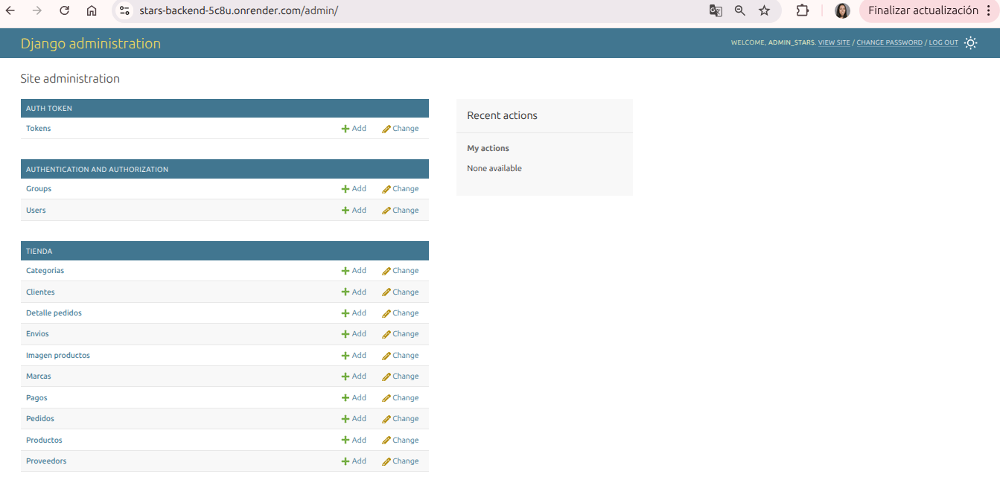
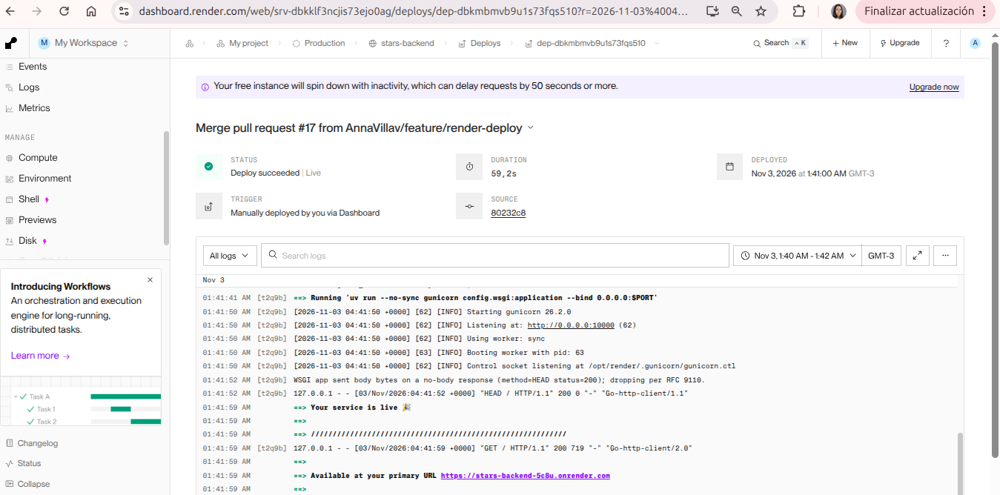

# STARS — Tienda de Instrumentos Musicales

**— Ingeniería de Software 2026 - Villaverde Anabella**

STARS es una tienda de instrumentos musicales desarrollada con Django y Django REST Framework. El proyecto permite administrar productos, categorías, marcas, proveedores, clientes y pedidos mediante una API REST.

El backend está preparado para comunicarse con un frontend desarrollado en Next.js.

## Tecnologías utilizadas

- Python 3.13
- Django 6.1
- Django REST Framework
- SQLite
- uv
- Docker
- django-filter
- django-cors-headers
- drf-spectacular
- Gunicorn y WhiteNoise
- Render
- Git y GitHub

## Diseño de la base de datos


El sistema cuenta con 10 modelos propios relacionados entre sí:

1. **Categoria:** organiza los productos.
2. **Marca:** identifica la marca de cada instrumento.
3. **Proveedor:** registra los proveedores.
4. **Producto:** contiene precios, ofertas, stock y relaciones con categoría, marca y proveedor.
5. **ImagenProducto:** permite asociar imágenes a los productos.
6. **Cliente:** relaciona los clientes con los usuarios de Django.
7. **Pedido:** registra las compras realizadas por los clientes.
8. **DetallePedido:** relaciona los pedidos con los productos comprados.
9. **Pago:** registra la información del pago de un pedido.
10. **Envio:** registra los datos de envío de un pedido.

También se utiliza el modelo de usuario proporcionado por Django para la autenticación.

Durante el desarrollo se realizaron algunos ajustes en los atributos de los modelos respecto de la planificación inicial. La estructura implementada se encuentra en `tienda/models.py`.

### Diagrama entidad-relación



[Ver diagrama en PDF](docs/STARS_Diagrama_BD.pdf)


## Funcionalidades de la API REST

La API permite consultar y administrar los recursos de STARS mediante ViewSets de Django REST Framework.

Entre las funcionalidades implementadas se encuentran:

- Endpoints para los 10 modelos.
- Operaciones CRUD según los permisos de cada recurso.
- Autenticación mediante sesión y token.
- Permisos para lectura pública del catálogo y escritura administrativa.
- Paginación de los listados.
- Búsqueda, filtros y ordenamiento de productos.
- Serializadores anidados en los listados de productos y pedidos.
- Acciones personalizadas para productos en oferta y productos con poco stock.
- Documentación mediante OpenAPI, Swagger y ReDoc.
- API navegable de Django REST Framework.
- Panel de administración Django con búsqueda y filtros.
- Vista principal con un template de bienvenida.
- Configuración de CORS para permitir la conexión con Next.js.


## API publicada en Render

**Backend público:** https://stars-backend-5c8u.onrender.com/

### Enlaces principales


| Página de bienvenida | https://stars-backend-5c8u.onrender.com/ |
| API REST | https://stars-backend-5c8u.onrender.com/api/ |
| Productos | https://stars-backend-5c8u.onrender.com/api/productos/ |
| Categorías | https://stars-backend-5c8u.onrender.com/api/categorias/ |
| Pedidos | https://stars-backend-5c8u.onrender.com/api/pedidos/ |
| Django Admin | https://stars-backend-5c8u.onrender.com/admin/ |
| Swagger | https://stars-backend-5c8u.onrender.com/api/swagger/ |
| ReDoc | https://stars-backend-5c8u.onrender.com/api/redoc/ |
| OpenAPI | https://stars-backend-5c8u.onrender.com/api/schema/ |


### Consultas de ejemplo

**Buscar guitarras:**

`GET /api/productos/?search=guitarra`

**Filtrar por categoría:**

`GET /api/productos/?categoria=2`

**Ordenar por precio descendente:**

`GET /api/productos/?ordering=-precio`

**Consultar la segunda página:**

`GET /api/productos/?page=2`

**Consultar ofertas:**

`GET /api/productos/ofertas/`

**Consultar productos con poco stock:**

`GET /api/productos/bajo-stock/`

## Ejecución local

### Requisitos

- Python 3.13
- uv
- Docker y Docker Compose

### Ejecutar con Docker

Clonar el repositorio:

```bash
git clone https://github.com/AnnaVillav/stars-backend.git
cd stars-backend
```

Construir e iniciar el backend:

```bash
docker compose up -d --build
```

Aplicar las migraciones:

```bash
docker compose exec backend uv run python manage.py migrate
```

Cargar el catálogo inicial, si la base de datos está vacía:

```bash
docker compose exec backend uv run python manage.py loaddata catalogo_stars
```

Abrir:

`http://localhost:8000/`

Para detener el servicio:

```bash
docker compose down
```

### Ejecución con uv sin Docker

Instalar las dependencias:

```bash
uv sync
```

Aplicar las migraciones:

```bash
uv run python manage.py migrate
```

Iniciar Django:

```bash
uv run python manage.py runserver
```

## Autenticación y permisos

La API utiliza autenticación por sesión y por token.

El token puede solicitarse mediante:

`POST /api/token/`

Los endpoints protegidos requieren la autenticación y los permisos correspondientes. Los usuarios administradores pueden gestionar los recursos del sistema desde Django Admin.

No se incluyen credenciales ni claves secretas en el repositorio.

## Despliegue

El backend está publicado en Render.

Para el despliegue se utilizaron:

- `build.sh` para instalar dependencias, preparar archivos estáticos, aplicar migraciones y cargar el catálogo inicial.
- `render.yaml` para configurar el servicio.
- Gunicorn para ejecutar Django.
- WhiteNoise para servir archivos estáticos.
- Variables de entorno para la configuración de seguridad y el administrador.

Actualmente se utiliza SQLite siguiendo el ejemplo básico de despliegue presentado en clase. En el servicio gratuito sin disco persistente, los datos creados en ejecución pueden perderse durante nuevos despliegues. Para un sistema de producción con datos permanentes sería recomendable utilizar una base de datos persistente.

## Organización del trabajo

El desarrollo se organizó mediante un tablero Kanban en Trello, utilizando tarjetas para planificar las tareas.

Se trabajó con Git y GitHub mediante ramas `main`, `develop` y `feature/*`, realizando commits descriptivos y Pull Requests.

**Tablero de Trello:** https://trello.com/b/rFMdPu8g/stars

## Evidencias del funcionamiento

Las capturas del sistema se incorporan en la carpeta `docs/capturas/`.

Se incluirán evidencias de:

- Página principal de STARS.
- Panel de administración.
- Listado de productos de la API REST.
- Documentación Swagger.
- Documentación ReDoc.
- Servicio publicado en Render.

## Estado del proyecto

Backend de STARS desarrollado y desplegado para la Evaluación Final Integradora de Ingeniería de Software 2026.

El frontend Next.js se desarrolla como proyecto complementario para Programación III y consumirá los endpoints públicos de esta API.


## Capturas del proyecto

### Página principal


### API REST de productos


### Documentación Swagger


### Panel de administración


### Despliegue en Render


